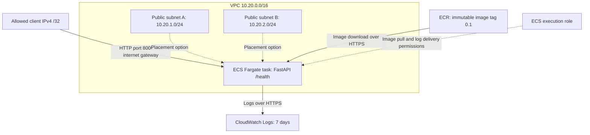

# Architecture of the completed AWS lab

Historical deployment in us-east-2; removed on 19 November 2026. One task was used when enabled; two public subnets provided placement options, not proof of two running replicas.

The task had a public IP, restricted inbound access, and outbound TCP 443 for image pulls and logs. There was no ALB, custom domain, TLS endpoint, NAT gateway, or PostgreSQL database.

Terraform ran from the developer workstation. Development state was stored in a separate encrypted, versioned S3 bucket with native lockfiles; bootstrap state was local and private. GitHub Actions ran tests/container health checks and Terraform formatting/validation. Image publishing and AWS deployment remained manual; IAM OIDC functionality was restricted in this account.

For teardown, development resources were removed first and the state bucket last. Evidence: [deployment and teardown](evidence/README.md).
