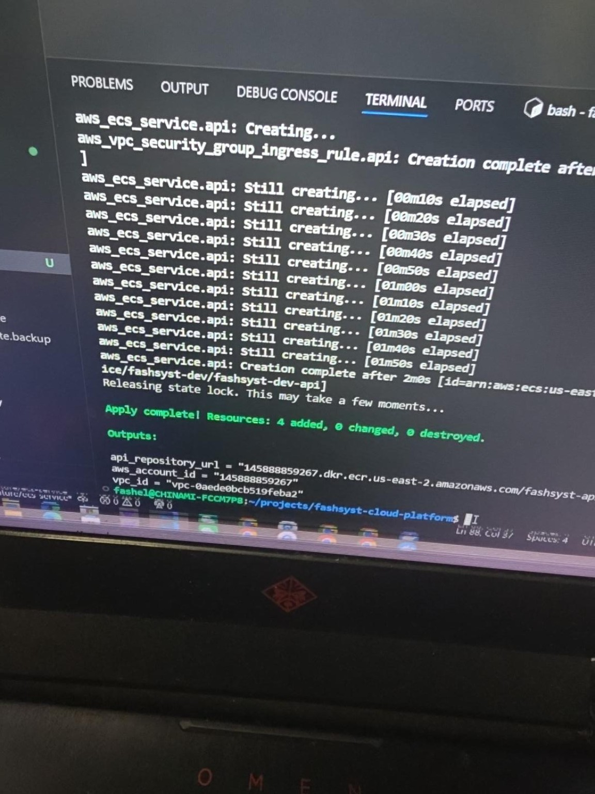
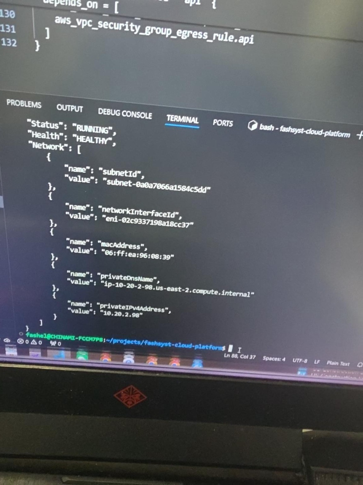
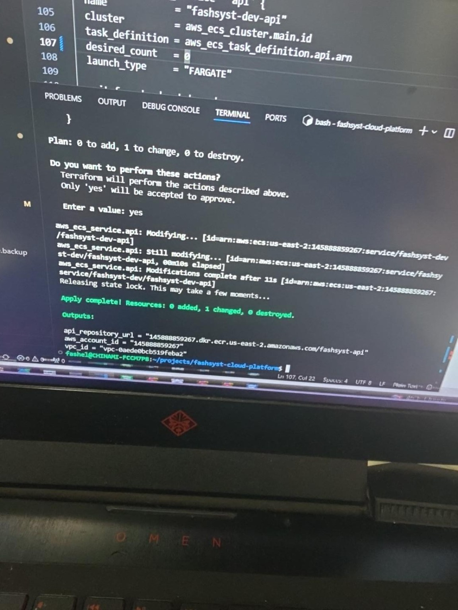
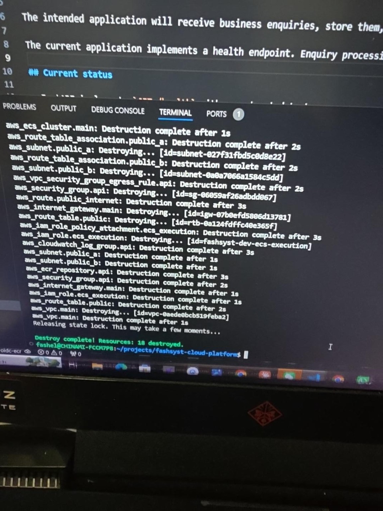
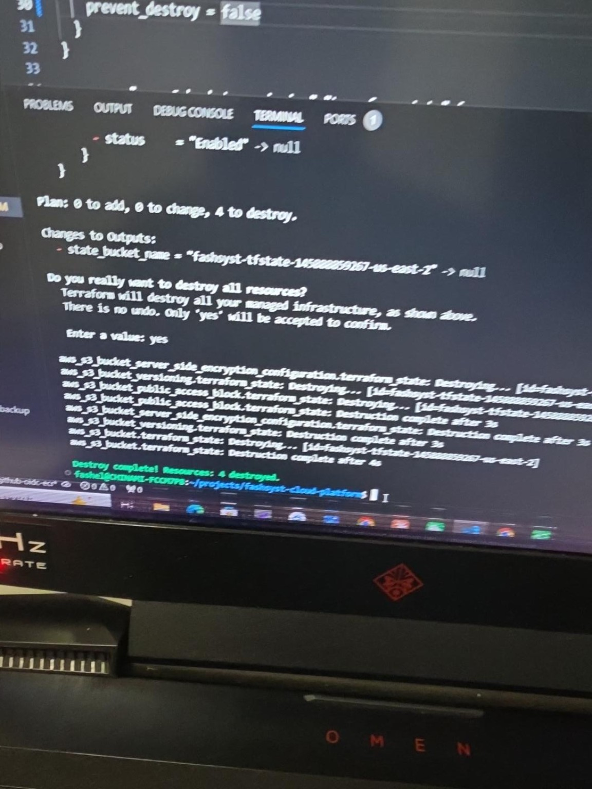
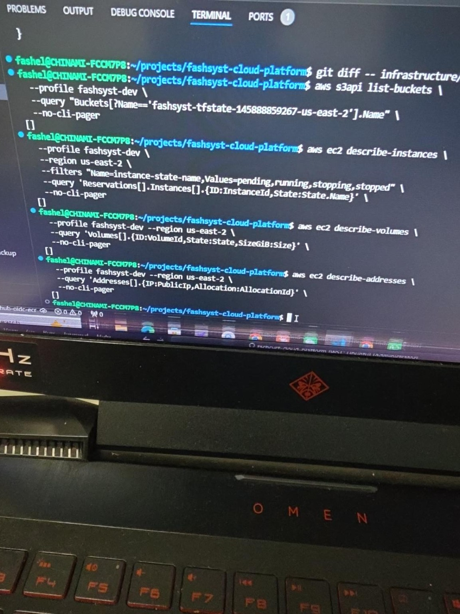

# Deployment and teardown evidence

These original photographs were selected from the project walkthrough. They show historical results, not a currently running service. No generated screenshots are used. Authentication/credential screenshots and state-file contents are excluded.

## Milestone

FastAPI health endpoint and automated test; non-root Docker container; GitHub Actions API/container checks and Terraform validation; Terraform VPC, public subnets, routing, security rules, ECR, ECS Fargate, execution role, CloudWatch logs, and versioned encrypted S3 state with native locking. See [repository workflows](../../.github/workflows/) for CI configuration and [Actions](https://github.com/K-adesh123/fashsyst-cloud-platform/actions) for run history. AWS deployment was manual.

## 1. ECS service creation

Terraform completed the four service/network access resources after the five ECS foundation resources had been provisioned.

## 2. Task health verification

The task description reported RUNNING and HEALTHY. This is container/task health evidence. The separate endpoint check was reported successful during the walkthrough; this photo does not itself show an HTTP response.

## 3. Pause between lab sessions

The service desired count was changed to zero through Terraform before final teardown. Pausing compute did not remove stored images, logs, or state.

## 4. Development teardown — 19 November 2026

Private state backups were saved outside the repository. ECR image entries were deleted and an empty image list verified before destroying the development resources. Terraform reported 18 resources destroyed.

## 5. Bootstrap teardown — 19 November 2026

The separate bootstrap state was backed up. The bucket safeguards were temporarily changed for intentional cleanup; force_destroy was applied before destroying the bucket and its configurations. Terraform reported four resources destroyed. Original safeguards were restored in source afterward. The bootstrap state list returned no entries.

## 6. Follow-up inventory checks

The exact former S3 bucket name returned an empty list. In us-east-2, the instance query (pending, running, stopping, stopped), EBS volume query, and Elastic IP query also returned empty lists. These checks do not constitute an all-service, all-region billing audit. The older diff visible at the top of this terminal photo is scrollback, not a claim about current file contents.

## Outcome and boundaries

22 Terraform-managed resources were destroyed across two configurations. Code, workflows, and documentation remain available. There is no live endpoint. No database or enquiry processing was implemented in this milestone. Automated AWS publishing/deployment, HTTPS, alarms, and recovery tests are deferred.
